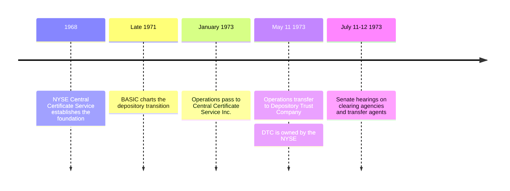

# TAD1
A history of the TAD concept as it was originally developed and contemplated by the SEC. This repo is anchored in direct historical sources and open to outside contributions. It should keep a neutral viewpoint, simply describing how the original documents framed out the TAD concept rather than discussing modern applications beyond the past records.

## Industry Development

The [DTC history and primary sources](history/dtc.md) document the 1973 transition. DTC's [1973 annual report](https://www.sechistorical.org/collection/papers/1970/1973_0101_DTCAR.pdf) traces the earlier milestones. The [Congressional Record notice](https://www.govinfo.gov/content/pkg/GPO-CRECB-1973-pt17/pdf/GPO-CRECB-1973-pt17-5-1.pdf) identifies the July 11–12 hearing dates. May 11 marks the documented transfer of operations, not necessarily DTC's earlier legal formation date.
