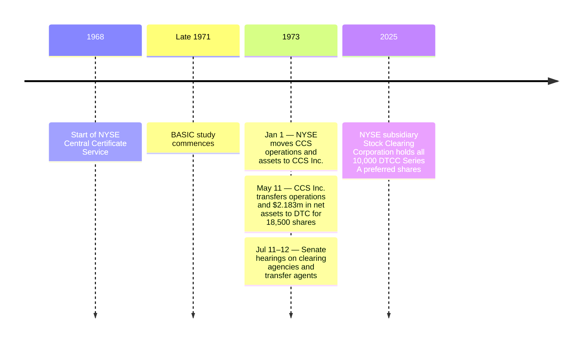

# xx-orgignal-- Transfer Agent Depository

A history of the TAD concept as it was originally developed and contemplated by the SEC. This repo is anchored in direct historical sources and open to outside contributions. It should keep a neutral viewpoint, simply describing how the original documents framed out the TAD concept rather than discussing modern applications beyond the past records.

## Industry Development

