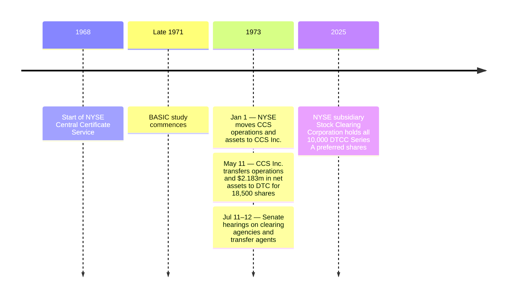

# Industry Development

[DTCC 2025 financial statements, p. 46](https://www.dtcc.com/-/media/Files/Downloads/legal/financials/2025/DTCC-Annual-Financial-Statement-2025.pdf#page=48) · [DTC history](dtc.md)
